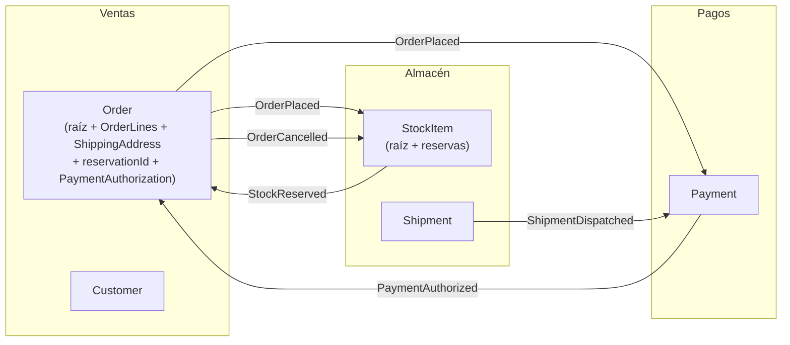

# Ejemplo: dimensionar los agregados de la tienda online

## Paso 1. Un agregado por entidad

Candidatos del Event Storming: `Order` (Ventas), `Payment` (Pagos), `StockItem` con sus reservas (Almacén), `Shipment` (Almacén), `Customer` (Ventas).

## Pasos 2 y 3. Reacciones y plazos (respuestas de los expertos, simuladas)

| Cuando cambia | Debe reaccionar | Plazo aceptado | Quién lo decide |
|---|---|---|---|
| Order realizado | StockItem reserva | 1 minuto | Jefe de logística: "hoy se hace en lote cada 5 minutos" |
| Order realizado | Payment autoriza | 1 minuto | Responsable de cobros |
| StockItem reservado + Payment autorizado | Order confirmado | 30 segundos | E-commerce |
| Order cancelado | StockItem libera reserva | 10 minutos | Logística |
| Shipment enviado | Payment captura | 1 día | Cobros |
| Order realizado | Customer: "último pedido" para marketing | 1 día | Marketing |
| Línea de pedido cambia | Total del pedido | **Inmediato** | E-commerce |

## Pasos 4 y 5. Decisión

* Líneas y total: inmediato → dentro de `Order` (como value objects).
* Todo lo demás admite plazo → agregados separados y consistencia eventual.
* "Último pedido" del cliente: no se toca `Customer` en la transacción del pedido; es una proyección para marketing.

Prueba con "¿de quién es el trabajo?": confirmar el pedido no es trabajo del cliente que compra, sino del sistema cuando llegan reserva y pago → eventual. Por eso el diseño del agregado evoluciona respecto al test del skill de descubrimiento (`order.confirm(authorization)`): ya no hay un comando "confirmar" que alguien invoque, sino un pedido que se confirma solo al registrar las dos condiciones. Es un ejemplo de cómo el análisis de agregados refina un escenario; actualiza el escenario y el glosario cuando ocurra.

## Resultado

`StockItem` sí agrupa sus reservas: la invariante "no reservar más unidades de las disponibles" es inmediata y la protege él. Si un mismo `StockItem` sufre muchos conflictos de concurrencia en campañas, la alternativa es partir el stock por almacén o por lote, no meter pedidos dentro.

El código de `Order` está en `implementacion-ts.md`.
