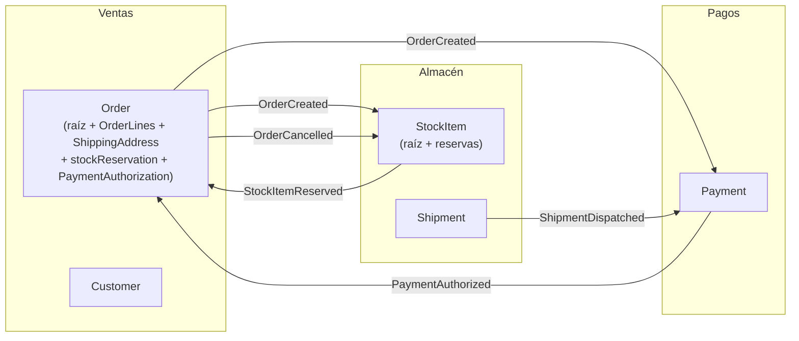

# Ejemplo: dimensionar los agregados de la tienda online

## Paso 1. Un agregado por entidad

Candidatos: `Order` (Ventas), `Payment` (Pagos), `StockItem` con sus reservas (Almacén), `Shipment` (Almacén), `Customer` (Ventas).

## Pasos 2 y 3. Reacciones y plazos

| Cuando cambia | Debe reaccionar | Plazo aceptado |
|---|---|---|
| Order realizado | StockItem reserva | 1 minuto |
| Order realizado | Payment autoriza | 1 minuto |
| StockItem reservado + Payment autorizado | Order confirmado | 30 segundos |
| Order cancelado | StockItem libera reserva | 10 minutos |
| Shipment enviado | Payment captura | 1 día |
| Order realizado | Customer: "último pedido" para marketing | 1 día |
| Línea de pedido cambia | Total del pedido | **Inmediato** |

## Pasos 4 y 5. Decisión

* Líneas y total: inmediato → dentro de `Order` (como value objects).
* Todo lo demás admite plazo → agregados separados y consistencia eventual.
* "Último pedido" del cliente: no se toca `Customer` en la transacción del pedido; es una proyección para marketing.

Prueba con "¿de quién es el trabajo?": confirmar el pedido no es trabajo del cliente que compra, sino del sistema cuando llegan reserva y pago → eventual. Por eso no hay un comando "confirmar" que alguien invoque (`order.confirm(authorization)`), sino un pedido que se confirma solo al registrar las dos condiciones.

## Resultado

`StockItem` sí agrupa sus reservas: la invariante "no reservar más unidades de las disponibles" es inmediata y la protege él. Si un mismo `StockItem` sufre muchos conflictos de concurrencia en campañas, la alternativa es partir el stock por almacén o por lote, no meter pedidos dentro.

El código de `Order` (sobre `AggregateRoot<OrderId>`, con `OrderLines`, `ShippingAddress` y `PaymentAuthorization` como `Composite`) está en `ddd-skills/ddd-agregados/references/implementacion-ts.md`. Las flechas del diagrama usan el nombre corto del hecho; en el código cada evento es `<Agregado><AcciónEnPasado>DomainEvent` (`OrderCreatedDomainEvent`, `'order.created'`). Cada flecha que llega a `Order` es un caso de uso por reacción `<Acción>On<Evento>` de Ventas, una sola clase con `@ListensTo` y su propia copia del evento de Almacén o de Pagos (`RegisterStockReservationOnStockItemReserved`, `RegisterPaymentAuthorizationOnPaymentAuthorized`); el primero está escrito en `ddd-skills/ddd-agregados/references/consistencia-eventual.md` y el segundo en `ddd-skills/ddd-agregados/references/implementacion-ts.md`.
