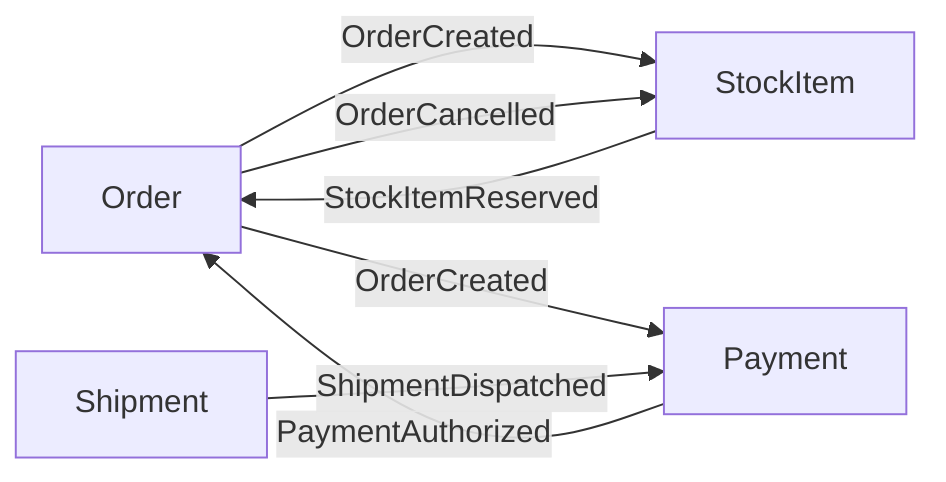

# Ejemplo: dimensionar la tienda online

Candidatos: `Order`, `Customer` (Ventas), `Payment` (Pagos), `StockItem`, `Shipment` (Almacén).

| Cuando cambia | Reacciona | Plazo |
|---|---|---|
| Order realizado | StockItem reserva; Payment autoriza | 1 minuto |
| StockItem reservado + Payment autorizado | Order confirmado | 30 segundos |
| Order cancelado | StockItem libera | 10 minutos |
| Shipment enviado | Payment captura | 1 día |
| Order realizado | "Último pedido" del cliente | 1 día |
| Línea de pedido cambia | Total del pedido | **Inmediato** |

* Líneas y total: inmediato → dentro de `Order` como valores.
* Lo demás, eventual; "último pedido" es una proyección, no se toca `Customer`.
* Confirmar no es trabajo del comprador sino del sistema → eventual: el pedido se confirma solo al registrar reserva y pago, sin comando `confirm`.
* `StockItem` agrupa sus reservas ("no reservar más de lo disponible" es inmediata); con muchos conflictos, se parte por almacén o lote, nunca se meten pedidos dentro.

Cada flecha hacia `Order` es una reacción de Ventas con su copia del evento: `RegisterStockReservationOnStockItemReserved` (`ddd-skills/ddd-agregados/references/consistencia-eventual.md`) y `RegisterPaymentAuthorizationOnPaymentAuthorized` (`ddd-skills/ddd-agregados/references/implementacion-ts.md`).
