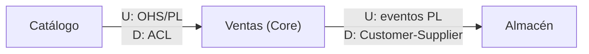

# Context Mapping

Una línea entre dos Bounded Contexts significa tres cosas a la vez: que hay **integración técnica**, que hay una **relación entre equipos** y que hay una **traducción entre dos lenguajes** [Destilado cap. 4]. Este skill decide el tipo de cada línea y cómo se implementa.

## Convenciones de la suite DDD

* **Trazabilidad.** Cada regla indica su origen: `[Destilado cap. N]`, `[IDDD cap. N]`, `[PHP: capítulo]`. Lo que no sale de esos libros va marcado `[Fuera de los libros]`. Respeta estas marcas al responder.
* **Idioma.** Responde en el idioma de la persona. El código de ejemplo es TypeScript.
* **Honestidad del modelo.** No presentes como validado lo que no ha pasado por los equipos implicados; si faltan datos, declara los supuestos.

## Flujo de trabajo

### Paso 1. Dibujar el presente

Mapea **la situación actual, no la imaginada**. Si el terreno cambia, se actualiza el mapa [IDDD cap. 3]. Para cada par de contextos que se relacionan, anota quién es upstream (U, de quien depende el otro) y quién downstream (D) [Destilado cap. 4].

El mapa es del equipo y para el equipo: informal, en la pared, sin ceremonia. No es un diagrama de arquitectura empresarial ni de topología [IDDD cap. 3]. Su valor principal es forzar conversaciones: un equipo que asume una relación Customer-Supplier con un sistema heredado que solo ofrece lo que ya tiene acaba descubriendo tarde que es Conformist [IDDD cap. 3].

### Paso 2. Elegir el patrón de relación para cada línea

Resumen [Destilado cap. 4]. Detalle, señales y costes en `references/patrones-relacion.md`.

| Patrón | Esencia |
|---|---|
| Partnership | Dos equipos que triunfan o fracasan juntos; sincronización frecuente e integración continua. Difícil de mantener; ponerle fecha de revisión |
| Shared Kernel | Pequeño modelo común compartido por acuerdo explícito. Difícil de mantener; se evita si es posible [IDDD cap. 2] |
| Customer-Supplier | Upstream decide qué recibe el downstream y cuándo, pero planifica con él |
| Conformist | Upstream no tiene motivación para atender al downstream, que adopta su modelo tal cual |
| Anticorruption Layer | El downstream traduce entre el modelo upstream y el suyo; la opción más defensiva |
| Open Host Service | El upstream ofrece un protocolo abierto, documentado y cómodo para cualquier integrador |
| Published Language | Formato de intercambio documentado (JSON Schema, Protobuf, Avro); suele ir con OHS |
| Separate Ways | No integrar: la integración no aporta lo suficiente |
| Big Ball of Mud | Sistema sin fronteras; si hay que integrarse, siempre con ACL y sin hablar su lenguaje |

Árbol de decisión rápido `[Fuera de los libros: síntesis de las definiciones]`:

1. ¿La integración aporta valor real? No → Separate Ways.
2. ¿Los dos equipos comparten objetivo y éxito? Sí → Partnership (con fecha de revisión).
3. ¿Eres downstream? Entonces:
   * ¿El upstream es un Big Ball of Mud o un producto externo? → ACL, siempre.
   * ¿Tu contexto es Core? → ACL, salvo coste desproporcionado.
   * ¿El upstream ofrece OHS con Published Language y su modelo se parece al tuyo? → Conformist puede ser aceptable.
   * ¿El upstream escucha tus necesidades? → Customer-Supplier, y aun así ACL si eres Core.
4. ¿Eres upstream con varios consumidores? → Open Host Service con Published Language.
5. ¿La tentación es compartir clases o tablas? → Para y revisa: casi siempre se resuelve mejor con Published Language.

### Paso 3. Elegir el estilo de integración

Vernon los ordena de menos a más robusto: RPC, REST, mensajería [Destilado cap. 4]. Detalle en `references/estilos-integracion.md`.

Reglas que aplican siempre:

* **Integración por base de datos o ficheros:** evitarla. Si es inevitable, aislar el modelo con ACL [Destilado cap. 4].
* **Asume los principios de la computación distribuida:** la red falla, hay latencia, el ancho de banda no es infinito, la red no es segura, la topología cambia, hay varios administradores, el transporte cuesta y la red es heterogénea [IDDD cap. 13].
* **Evita los choques de trenes de integración:** si C0 hace una petición bloqueante a C1, C1 no debe hacer a su vez una petición bloqueante a S1 para responderla. Usa mensajería [Destilado cap. 4].
* **Recursos REST sintéticos:** diseñados para los casos de uso del cliente, no como espejo de los agregados. Exponer el modelo tal cual obliga a todos a ser Conformist [Destilado cap. 4; IDDD cap. 13].
* **Los consumidores dependen del esquema, no de las clases del productor.** Leen el Published Language (por ejemplo JSON) y lo traducen a sus propios tipos [Destilado cap. 4; IDDD cap. 13].
* **Mensajería:** el mecanismo debe garantizar entrega al menos una vez y el receptor debe ser idempotente [Destilado cap. 4].
* **Estado remoto mínimo:** copia solo los atributos que tu modelo necesita y modélalos con tus conceptos. Si no, tu `ProductOwner` acaba siendo un `User` disfrazado [IDDD cap. 3].
* **La indisponibilidad se modela:** "todavía no está" es un estado válido del dominio, no un error. IDDD lo resuelve con un estado explícito en un value object [IDDD cap. 3].

### Paso 4. Diseñar la traducción

Para cada relación con ACL, define puerto, adaptador y traductor. Implementación en TypeScript en `references/anticorrupcion-ts.md`.

Para cada evento que cruza un contexto, decide entre **evento enriquecido** (más autonomía del consumidor, pero difícil prever todo y riesgo de exponer datos sensibles) o **evento ligero con consulta al origen** (query-back), o una mezcla [Destilado cap. 4].

## Entregable

Usa `assets/plantilla-context-map.md`. Contiene: diagrama, una ficha por relación (patrón, U/D, estilo, contrato, traducción, dueño, riesgos) y la lista de eventos que cruzan fronteras.

Notación del diagrama en Mermaid:

Convención: la flecha va de upstream a downstream y la etiqueta indica el patrón en cada extremo.

## Señales de alarma

* Un contexto importa tipos (clases, interfaces, enums) del dominio de otro.
* Tablas compartidas entre equipos.
* API REST que devuelve el agregado serializado con todos sus campos.
* Una petición de usuario que atraviesa tres servicios en cadena de forma síncrona.
* Un consumidor de eventos sin control de duplicados.
* "Shared Kernel" usado como excusa para compartir una librería de modelos que crece sin acuerdo [IDDD cap. 13].
* Un Partnership que lleva años sin revisarse.
* Ninguna relación aparece como Conformist en el mapa, pero el código copia sin traducir el modelo de un proveedor.

## Ejemplo completo

`references/ejemplo-ecommerce.md` continúa la tienda online: mapa con todas las relaciones, decisiones razonadas y eventos que cruzan fronteras.

## Siguiente skill

* Estructura interna de cada contexto y dónde vive el ACL → `ddd-arquitectura`.
* Diseño de los eventos que se publican → `ddd-eventos-dominio`.
* Consistencia eventual entre agregados y procesos → `ddd-agregados`.
