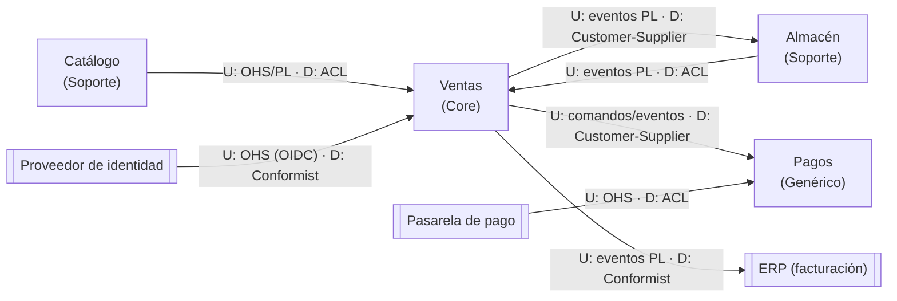

# Ejemplo completo: context map de la tienda online

Continúa el mapa estratégico de `ddd-skills/ddd-subdominios-bounded-contexts/GUIA.md`.

## Diagrama

## Fichas de relación

| Relación | Patrón U / D | Estilo | Por qué |
|---|---|---|---|
| Catálogo → Ventas | OHS + PL / ACL | REST (query-back al realizar el pedido) | Ventas es Core y solo necesita referencia, nombre y precio web. Copia el precio en la línea |
| Ventas → Almacén | PL de eventos / Customer-Supplier | Mensajería | Almacén reacciona a `PedidoRealizado` y `PedidoCancelado`; Ventas planifica cambios con Logística |
| Almacén → Ventas | PL de eventos / ACL | Mensajería | Ventas traduce `StockReservado` a "reserva registrada en el pedido" |
| Ventas ↔ Pagos | Customer-Supplier | Mensaje de comando `AutorizarPago` y eventos de vuelta | Pagos atiende las necesidades de Ventas; mismo equipo |
| Pasarela → Pagos | OHS / ACL | Webhooks + REST | Producto externo: nunca su lenguaje en nuestro modelo |
| Ventas → ERP | PL / Conformist (ERP como consumidor) | Mensajería con integración del ERP | El ERP factura con su modelo; Administración adapta |
| Proveedor de identidad → Ventas | OHS (OIDC) / Conformist | Tokens | Estándar abierto y estable; Ventas solo extrae `customerId` del token en la capa de aplicación |

Nota sobre el ERP: Ventas es upstream porque publica sus eventos y no se adapta al ERP. El conector del ERP es el que se conforma al Published Language de Ventas.

## Eventos que cruzan fronteras

| Evento | Productor | Consumidores | Contenido | Estrategia |
|---|---|---|---|---|
| PedidoRealizado | Ventas | Almacén, Pagos | orderId, líneas (sku, cantidad), total | Enriquecido: Almacén necesita las líneas para reservar |
| PedidoConfirmado | Ventas | Almacén, ERP | orderId, fecha | Ligero; ERP consulta el detalle facturable por REST |
| PedidoCancelado | Ventas | Almacén, Pagos | orderId, motivo | Ligero |
| StockReservado | Almacén | Ventas | orderId, reservationId | Ligero |
| ReservaFallida | Almacén | Ventas | orderId, skus sin stock | Enriquecido con los skus para informar al cliente |
| PagoAutorizado | Pagos | Ventas | orderId, paymentId, importe, caducidad | Enriquecido: Ventas comprueba que cubre el total |
| ExpediciónEnviada | Almacén | Ventas, Pagos | orderId, fecha | Pagos captura el cobro al enviar |

El correo y la dirección del cliente no viajan en ningún evento hacia Almacén: Almacén consulta los datos de envío por REST con autorización, solo para pedidos confirmados (minimización de datos).

## Proceso de larga duración: confirmación de pedido

Estado del proceso `ConfirmaciónDePedido` en Ventas:

| Estado | Entra con | Sale con |
|---|---|---|
| EsperandoReservaYPago | PedidoRealizado | StockReservado + PagoAutorizado → Confirmado |
| Confirmado | ambas condiciones | (fin) |
| Fallida | ReservaFallida o PagoRechazado | comandos compensatorios: LiberarReserva, AnularAutorización |
| Caducada | 30 minutos sin completar | mismas compensaciones |

Las compensaciones son comandos de negocio con nombre. El plazo de 30 minutos es una decisión de negocio a validar.
