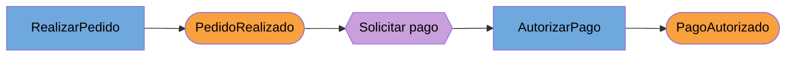

# Event Storming en detalle

Contenido:
1. Qué es y por qué funciona
2. Niveles: alto nivel y nivel de diseño
3. Personas, actitud y material
4. Los pasos con sus reglas
5. Agenda tipo y facilitación
6. Variante remota
7. Notación textual para trabajar con Claude
8. Errores frecuentes
9. Preguntas semilla

## 1. Qué es y por qué funciona

Técnica de Alberto Brandolini para aprender rápido un dominio juntando expertos y desarrolladores ante una pared con notas adhesivas. Pone el foco en el proceso de negocio y en lo que ocurre, no en sustantivos ni en datos [Destilado cap. 7]. Ventajas que destaca Vernon [Destilado cap. 7]:

* Todos participan en igualdad: cada persona tiene notas y rotulador.
* Es visual y saca el código de la conversación.
* Es barato: un error cuesta una nota que se tira, así que nadie defiende ideas por lo invertido.
* Todos salen sabiendo más, también quien creía conocer ya el negocio.
* Los malentendidos aparecen pronto, antes de llegar al código.

## 2. Niveles

* **Alto nivel (estratégico):** menos preciso, sirve para ver el proceso completo, los subdominios y los contextos.
* **Nivel de diseño:** lleva a artefactos concretos de software (comandos, agregados, eventos).

Es normal pasar de uno a otro en la misma sesión cuando una zona pide detalle [Destilado cap. 7]. Si ves que la sesión baja a nivel de diseño en una zona que no es el Core Domain, vuelve a subir.

## 3. Personas, actitud y material

Personas [Destilado cap. 7]:
* Expertos del dominio y los desarrolladores que trabajarán en el modelo, en la misma sala.
* Mente abierta. El error típico es querer ser correcto demasiado pronto.

Material [Destilado cap. 7]:
* Notas cuadradas de pegamento fuerte en naranja, púrpura o rojo, azul, amarillo, lila y rosa. Verde opcional.
* Rotulador negro de punta gruesa por persona; se escriben pocas palabras.
* Rollo de papel en una pared de al menos 10 m de ancho y 1 m de alto. El ancho importa más que el alto. La pizarra funciona poco tiempo porque las notas se despegan.

Códigos de color usados en esta suite (los de Vernon) [Destilado cap. 7]:

| Color | Elemento |
|---|---|
| Naranja | Evento de dominio (pasado) |
| Púrpura / rojo | Hotspot: duda, conflicto, problema |
| Azul | Comando (imperativo) |
| Amarillo pequeño con muñeco | Rol o actor |
| Lila | Proceso o política disparada por un evento o comando |
| Amarillo | Agregado o entidad (sustantivo) |
| Rosa | Nombre de un Bounded Context o límite provisional |
| Verde | Vista o pantalla relevante |

Brandolini y otras fuentes usan colores algo distintos (por ejemplo rosa para sistemas externos). Lo importante es que el equipo fije una leyenda y la ponga visible en la pared `[Fuera de los libros]`.

## 4. Los pasos con sus reglas

### Paso 1. Eventos

* Nombre en pasado: `PedidoRealizado`, `PagoAutorizado`. Si en una sesión estratégica los nombres resultan demasiado técnicos para los asistentes, usa otros más naturales [Destilado cap. 7].
* Orden temporal de izquierda a derecha. Si no se sabe el orden, pon el evento en cualquier sitio; el "cuándo" suele aclararse después.
* Paralelismo en vertical.
* Marca los puntos problemáticos con púrpura y una frase que explique el problema.
* Si un evento dispara un proceso, nota lila y flecha. Modela en detalle solo lo que importa al Core Domain; lo genérico (registro de usuario) se queda en un evento [Destilado cap. 7].
* Este paso solo trata del proceso. Deja 10 a 15 minutos de arranque y no permitas saltar al siguiente [Destilado cap. 7].
* Cuando parezca agotado, descansa y vuelve otro día: aparecen eventos que faltaban y se eliminan los superficiales [Destilado cap. 7].

### Paso 2. Comandos

* Imperativo: `RealizarPedido`, `AutorizarPago`. Va a la izquierda de su evento, formando pares comando/evento.
* No todo evento tiene comando: algunos vienen de otros sistemas y otros de que pasa el tiempo (`PlazoDePagoVencido`) [Destilado cap. 7].
* Un comando puede causar varios eventos; ponlo a la izquierda de todos.
* Añade el rol solo si importa quién lo ejecuta.
* Es normal descubrir eventos nuevos en este paso. Añádelos.

### Paso 3. Agregados

* Nota amarilla con un sustantivo, detrás y algo por encima de sus pares comando/evento.
* Si a negocio le confunde "agregado", llámalo entidad o datos [Destilado cap. 7].
* **No reordenes la línea temporal** para agrupar todo bajo un agregado. Repite la nota del agregado donde haga falta [Destilado cap. 7].
* Si un agregado acumula demasiado, puede convenir partirlo en un proceso gestionado (lila) [Destilado cap. 7]. Esto se decide con detalle en `ddd-agregados`.

### Paso 4. Límites y flujos (opcional)

* Hay límites donde hay divisiones departamentales, personas de negocio con definiciones en conflicto para un mismo término, o conceptos importantes que no son del núcleo [Destilado cap. 7].
* Primero marca con notas rosa (provisional) y solo con rotulador cuando haya confianza.
* Flechas para eventos que llegan de otros contextos.

### Paso 5. Vistas y roles (opcional)

Solo las pantallas que requieran cuidado especial, en verde, con un boceto rápido si ayuda [Destilado cap. 7].

## 5. Agenda tipo y facilitación

Vernon recomienda sesiones de dos a tres horas, repetidas en días consecutivos, unos tres o cuatro días para entender a fondo el núcleo [Destilado cap. 7]. Agenda propuesta `[Fuera de los libros, organizada a partir de esas pautas]`:

| Día | Duración | Contenido |
|---|---|---|
| 1 | 2 a 3 h | Pasos 1 y 2 sobre el proceso completo. Cierre con hotspots priorizados |
| 2 | 2 h | Revisión en frío, pasos 2 y 3 en las zonas del Core Domain |
| 3 | 2 h | Paso 4 (límites) y escenarios concretos de los hotspots principales |
| 4 | 1 a 2 h | Validar glosario y escenarios; plan de modelado |

Pautas para quien facilita `[Fuera de los libros]`:
* Abre explicando la leyenda de colores y la regla de "más eventos que menos".
* No escribas tú las notas: pide que las escriba quien sabe.
* Cuando dos expertos discrepen, no lo resuelvas en el momento: hotspot y seguir. Las discrepancias suelen señalar límites de contexto.
* Lee la línea temporal en voz alta de izquierda a derecha cada cierto tiempo. Los huecos se oyen.

## 6. Variante remota

No está en los libros `[Fuera de los libros]`. Funciona con una pizarra digital (Miro, Mural o Whiteboard de Microsoft 365) si se cuidan tres cosas: la leyenda fijada al principio del tablero, sesiones más cortas (90 minutos) y una persona por zona del proceso en los primeros 20 minutos para que todos escriban a la vez. Comprueba antes que la herramienta esté aprobada por la organización para la información que se va a tratar.

## 7. Notación textual para trabajar con Claude

En los modos B y C representa el tablero como una tabla ordenada en el tiempo. Una fila por par comando/evento:

```markdown
| # | Actor | Comando | Agregado | Evento | Política / proceso | Hotspot | Contexto candidato | Estado |
|---|---|---|---|---|---|---|---|---|
| 1 | Cliente | RealizarPedido | Pedido | PedidoRealizado | Al realizar pedido, solicitar autorización de pago | | Ventas | por validar |
| 2 | (sistema) | AutorizarPago | Pago | PagoAutorizado | | ¿Qué pasa si caduca la autorización? | Pagos | por validar |
```

Reglas de la notación:
* Filas en orden temporal. El paralelismo se indica con el mismo número y letra (`3a`, `3b`).
* Eventos sin comando: columna Comando vacía y Actor `(tiempo)` o `(externo: <sistema>)`.
* `Estado`: `por validar` (hipótesis), `validado` (confirmado por un experto) o `descartado`. Nunca borres filas descartadas en el modo C; sirven para el glosario de términos rechazados.

Si ayuda a la lectura, añade un diagrama Mermaid del flujo principal, sin intentar volcar el tablero entero:



## 8. Errores frecuentes

* Empezar por datos o por un modelo entidad-relación [Destilado cap. 7].
* Querer que cada nota sea correcta a la primera [Destilado cap. 7].
* Reordenar la línea temporal para agrupar por agregado [Destilado cap. 7].
* Detallar procesos genéricos [Destilado cap. 7].
* Hacer la sesión sin expertos del dominio [Destilado cap. 7].
* Sesiones de un día entero: el cansancio baja la calidad; mejor bloques cortos en varios días [Destilado cap. 7].
* Confundir el tablero con el modelo. El tablero es una herramienta para llegar al modelo; el modelo vive en el código [Destilado cap. 2].

## 9. Preguntas semilla

Para arrancar o desbloquear `[Fuera de los libros]`:
* ¿Cuál es el primer momento en que esto importa al negocio? ¿Y el último?
* ¿Qué tiene que haber pasado antes de que esto pueda ocurrir?
* ¿Qué pasa si esto no ocurre a tiempo?
* ¿Quién se entera cuando esto pasa? ¿Qué hace con ello?
* ¿Hay algún caso en el que esto se deshaga, se cancele o se corrija?
* ¿Esta palabra significa lo mismo para vosotros dos?
