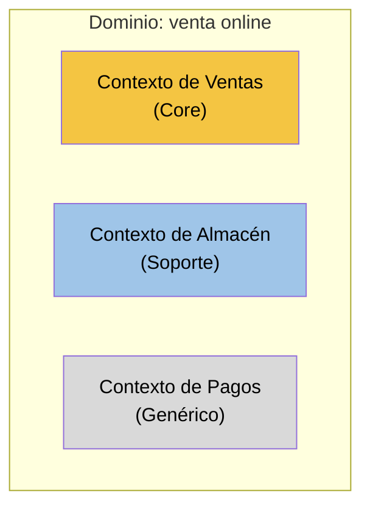

# Subdominios y Bounded Contexts

> Parte del skill `archi-code-ddd`: léela solo cuando ese skill te dirija aquí. Para escribir el código, traduce los ejemplos con `ddd-skills/archi-code-ddd/suite-to-package.md`; si esta guía y las reglas del paquete discrepan, ganan las del paquete.
>
> **Cuándo consultar esta guía.** Diseño estratégico DDD para dividir un dominio en subdominios (Core Domain, de soporte, genéricos) y trazar Bounded Contexts por fronteras lingüísticas. Cubre espacio del problema frente a espacio de la solución, criterios de clasificación y de inversión (construir, comprar, subcontratar), tamaño correcto de un contexto, qué vive dentro de él, un equipo por contexto, alineación 1:1 subdominio-contexto y cómo analizar un sistema legado o Big Ball of Mud como subdominios lógicos. Consúltala siempre que alguien pregunte cómo dividir un sistema, cuántos microservicios o módulos hacer, qué es core y qué no, dónde poner un concepto que significa cosas distintas para distintos equipos, cómo partir un monolito, o cuando una clase o tabla "lo tiene todo", aunque no mencione Bounded Context.

## Con @archi-code/ddd

[Fuera de los libros: convención de @archi-code/ddd]

* Un contexto nunca importa a otro, salvo un `shared-kernel/` explícito; la estructura por contexto está en `ddd-skills/archi-code-ddd/where-each-class-goes.md`.

Esta guía decide **dónde están las fronteras** y **cuánto invertir en cada zona**. Son las dos decisiones estratégicas que más condicionan todo lo demás: un agregado bien diseñado dentro de un contexto mal trazado sigue siendo un problema.


## Dos conceptos que no se deben mezclar

| | Subdominio | Bounded Context |
|---|---|---|
| Espacio | Del **problema**: qué parte del negocio hay que resolver | De la **solución**: qué modelo de software la resuelve [IDDD cap. 2] |
| Qué es | Un área de conocimiento del negocio con sus expertos [Destilado cap. 3] | Una frontera explícita y **lingüística** dentro de la cual cada término tiene un significado preciso [IDDD cap. 2] |
| Se clasifica en | Core, de soporte, genérico | No se clasifica: se nombra `<Modelo> Context` [IDDD cap. 2] |
| Pregunta que responde | ¿Dónde invertimos? | ¿Dónde cambia el significado de las palabras? |

El objetivo es alinearlos **1:1**: un subdominio por contexto y un contexto por subdominio [Destilado cap. 3; IDDD cap. 2]. En proyectos nuevos es alcanzable; en sistemas heredados casi nunca, y no pasa nada mientras se sepa [IDDD cap. 2].

## Flujo de trabajo

### Paso 1. Espacio del problema: identificar y clasificar subdominios

Parte de los contextos candidatos del descubrimiento (si existen) o de las funciones del negocio. Para cada subdominio decide su tipo con `ddd-skills/ddd-subdominios-bounded-contexts/references/clasificacion-subdominios.md`. Resumen [Destilado cap. 3; IDDD cap. 2]:

* **Core Domain:** donde la organización debe ser excelente porque la distingue. Máxima prioridad, los mejores desarrolladores y expertos con conocimiento profundo.
* **De soporte:** necesario y específico del negocio (no se puede comprar hecho), pero no diferencia. Desarrollo a medida con menos inversión; candidato a subcontratar.
* **Genérico:** nada especial del negocio; se compra, se subcontrata o lo hace un equipo sin perfil de élite.

Responde las preguntas del espacio del problema [IDDD cap. 2]: nombre y visión del Core Domain; qué conceptos forman parte de él; qué subdominios de soporte y genéricos necesita; quién trabajará en cada área; si se pueden formar los equipos adecuados.

Los subdominios se validan con expertos. Si no los hay, la clasificación sale como hipótesis.

### Paso 2. Espacio de la solución: trazar Bounded Contexts

Usa `ddd-skills/ddd-subdominios-bounded-contexts/references/delimitar-bounded-contexts.md`. Las reglas que no se negocian:

1. **La frontera es lingüística.** Se traza donde un término cambia de significado, no donde lo pide la tecnología [IDDD cap. 2]. Un modelo único para toda la empresa fracasa [IDDD cap. 2].
2. **Tamaño:** tan grande como haga falta para expresar el lenguaje completo, ni más ni menos [IDDD cap. 2]. Lo que no pertenece al lenguaje sale; lo esencial no se recorta.
3. **No partir por razones técnicas ni de reparto de tareas.** Plataforma, framework, despliegue o "dar trabajo a cada equipo" producen contextos falsos y lenguaje fragmentado. El reparto de tareas se resuelve con módulos [IDDD cap. 2].
4. **Un equipo por contexto.** Un equipo puede llevar varios contextos; varios equipos no deben compartir uno [Destilado cap. 2; IDDD cap. 2].
5. **Dentro del contexto** viven el modelo y lo que lo sirve: interfaz, servicios de aplicación, endpoints, y el esquema de base de datos si lo diseña el propio equipo [IDDD cap. 2].
6. **Código y esquema separados por contexto**, con los tests junto al código [Destilado cap. 2].

Nombra cada contexto por su modelo: `Contexto de Ventas`, `Contexto de Almacén` [IDDD cap. 2].

### Paso 3. Alinear subdominios y contextos

Construye la tabla de alineación (plantilla en `ddd-skills/ddd-subdominios-bounded-contexts/assets/plantilla-mapa-estrategico.md`). Para cada desalineación decide:

* **Dos subdominios en un contexto:** si no es práctico separarlos, separa el secundario en un **módulo** propio dentro del contexto, como declaración explícita de que no es el núcleo [Destilado cap. 3]. Ojo: un módulo ordena el código pero **no arregla un lenguaje mezclado** [IDDD cap. 2]. Si los términos chocan, hacen falta dos contextos.
* **Un subdominio repartido en varios contextos:** habitual en sistemas heredados y en integraciones con productos externos [IDDD cap. 2]. Documéntalo y planifica la traducción en `ddd-skills/ddd-context-mapping/GUIA.md`.

### Paso 4. Si hay sistemas heredados

Analiza la Big Ball of Mud como un conjunto de **subdominios lógicos** aunque el código no los separe. Así se piensa en ella como si tuviera varios lenguajes, se decide cuáles importan al proyecto y cómo integrarse [Destilado cap. 3]. Guía en `ddd-skills/ddd-subdominios-bounded-contexts/references/legado-big-ball-of-mud.md`.

### Paso 5. Decidir la inversión

Para cada contexto, una estrategia coherente con su tipo. Tabla de decisión en `ddd-skills/ddd-subdominios-bounded-contexts/references/clasificacion-subdominios.md`.

### Paso 6. Destilar el Core Domain

Clasificar no basta: el núcleo tiende a quedar enterrado bajo funcionalidad de soporte a medida que el código crece. Aplica los patrones de destilación de `ddd-skills/ddd-subdominios-bounded-contexts/references/destilacion-core.md`:

* **Domain Vision Statement** siempre: una página con qué hace diferente al núcleo y qué no es núcleo. Responde a la pregunta de IDDD sobre nombre y visión del Core Domain [IDDD cap. 2].
* **Highlighted Core** cuando el núcleo ya existe en código: hacerlo visible (documento de destilación breve, núcleo marcado en el repositorio).
* **Segregated Core** cuando un contexto crítico mezcla su núcleo con soporte: separarlo en módulos como paso previo a extraer contextos [IDDD cap. 2].
* **Cohesive Mechanisms** para algoritmos complejos que no son conocimiento del negocio.

Varios de estos patrones son de Evans y no están desarrollados en las fuentes del proyecto; la referencia los marca.

## Entregable

```markdown
# Mapa estratégico: <dominio>
Estado: hipótesis | validado con <expertos, DD/MM/AAAA>

## 1. Visión del Core Domain (Domain Vision Statement, ver references/destilacion-core.md)
## 2. Subdominios (nombre, tipo, por qué, experto de referencia)
## 3. Bounded Contexts (nombre, qué lenguaje encierra, equipo, repositorio, esquema propio sí/no)
## 4. Alineación subdominio ↔ contexto y desalineaciones aceptadas
## 5. Términos que cambian de significado entre contextos
## 6. Estrategia de inversión por contexto (construir con DDD completo, a medida simple, comprar, subcontratar)
## 7. Diagrama (Mermaid)
## 8. Riesgos y preguntas abiertas
## 9. Siguiente paso: relaciones entre contextos (ddd-skills/ddd-context-mapping/GUIA.md)
```

Diagrama mínimo:



## Señales de alarma

* Una entidad "maestra" compartida por todos (`Customer` con 60 campos, `Product` usado por catálogo, ventas, almacén y facturación). Es un modelo único de empresa disfrazado.
* Contextos llamados como capas o tecnologías (`ApiContext`, `BackendService`, `DataService`).
* Un contexto por entidad o por tabla. Vernon advierte contra miniaturizar: a menudo un único contexto con módulos basta [IDDD cap. 2].
* Usuarios, permisos o tenants mezclados en el modelo del núcleo. El caso de estudio de IDDD muestra cómo esto ensucia el lenguaje; el núcleo habla de roles de negocio (`Author`, `Moderator`), no de usuarios [IDDD cap. 2].
* Dos equipos haciendo commits en el mismo modelo sin un Shared Kernel acordado.
* Tratar como Core algo que se puede comprar (autenticación, envío de correo, pasarela de pago).
* Etiquetar el Core Domain como "en mantenimiento". Si no merece aprendizaje continuo, quizá no es Core [Destilado cap. 2].
* Nadie sabe señalar en el repositorio dónde está el núcleo. Falta destilación (Highlighted Core).

## Microservicios y Bounded Contexts

Vernon considera los microservicios básicamente equivalentes a Bounded Contexts. Si se prefieren microservicios más pequeños (uno por concepto), varios de ellos pertenecen al **mismo contexto lingüístico**; se despliegan por separado, pero comparten lenguaje [Destilado cap. 2]. Consecuencia práctica: la frontera de despliegue no autoriza a cambiar el significado de los términos.

## Ejemplo completo

`ddd-skills/ddd-subdominios-bounded-contexts/references/ejemplo-ecommerce.md` continúa el caso de la tienda online de la guía de descubrimiento hasta el mapa estratégico completo.

## Siguiente guía

* Relaciones entre contextos, integración y traducción → `ddd-skills/ddd-context-mapping/GUIA.md`.
* Estructura de carpetas, capas y módulos dentro de cada contexto → `ddd-skills/ddd-arquitectura/GUIA.md`.
