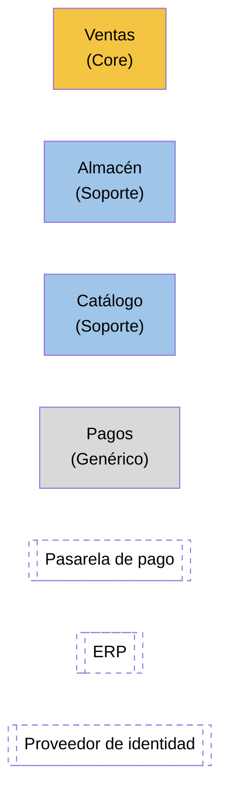

# Ejemplo completo: mapa estratégico de la tienda online

Continúa el caso de `ddd-skills/ddd-descubrimiento-dominio/GUIA.md` (venta online de menaje). Supuesto: los hotspots se han resuelto con los expertos así: el stock se reserva al realizar el pedido, no se admite reserva parcial y la autorización de pago dura 7 días.

---

# Mapa estratégico: venta online de menaje
Estado: validado con responsable de e-commerce y jefe de logística (simulado para el ejemplo)

## 1. Visión del Core Domain

Vender sin romper promesas: ningún pedido confirmado sin stock y preventa con fecha de entrega fiable.

## 2. Subdominios

| Subdominio | Tipo | Por qué | Experto |
|---|---|---|---|
| Gestión de pedidos y preventa | Core | Diferencia frente a marketplaces; reglas que cambian por campaña | Responsable de e-commerce |
| Logística de almacén | Soporte | Reglas propias (ubicaciones, preparación), pero no diferencia | Jefe de logística |
| Catálogo | Soporte | Fichas específicas del negocio, sin ventaja competitiva | Responsable de producto |
| Cobros | Genérico | Lo resuelve una pasarela de pago | Responsable de cobros |
| Identidad y acceso | Genérico | Lo resuelve el proveedor de identidad | (IT) |
| Facturación | Genérico | Lo resuelve el ERP | Administración |

## 3. Bounded Contexts

| Contexto | Lenguaje que encierra | Equipo | Esquema propio |
|---|---|---|---|
| Contexto de Ventas | Pedido, Línea de pedido, Cliente, Preventa, Confirmar, Cancelar | Equipo Ventas | Sí |
| Contexto de Almacén | Existencia, Reserva, Expedición, Bulto, Ubicación | Equipo Logística | Sí |
| Contexto de Catálogo | Producto, Ficha, Variante, Precio de tarifa | Equipo Logística | Sí |
| Contexto de Pagos | Pago, Autorización, Captura, Devolución | Equipo Ventas (integración) | Sí, mínimo |
| Pasarela de pago (externo) | Su API | Proveedor | No |
| ERP (externo) | Factura, Asiento | Administración | No |
| Proveedor de identidad (externo) | Usuario, Rol | IT | No |

Decisión discutida: Catálogo y Almacén los lleva el mismo equipo. Es válido (un equipo, varios contextos), pero se mantienen como contextos separados porque "Producto" en catálogo (ficha con fotos y textos) y "Existencia" en almacén (unidades físicas en ubicaciones) son lenguajes distintos.

## 4. Alineación

| Subdominio | Contexto(s) | Situación |
|---|---|---|
| Gestión de pedidos y preventa | Ventas | 1:1 |
| Logística de almacén | Almacén | 1:1 |
| Catálogo | Catálogo | 1:1 |
| Cobros | Pagos + pasarela externa | 1:2 aceptado: el contexto de Pagos solo adapta la pasarela al lenguaje de Ventas |
| Facturación | ERP | Externo |

## 5. Términos que cambian de significado

| Término | En Ventas | En Almacén | En Catálogo |
|---|---|---|---|
| Producto | Referencia y precio fijado en la línea del pedido | No se usa: se habla de Existencia | Ficha completa con variantes |
| Pedido | Compromiso de compra del cliente | No se usa: se habla de Expedición | No se usa |
| Cliente | Quien compra, con su dirección de envío del pedido | Destinatario de la expedición | No se usa |

## 6. Inversión por contexto

| Contexto | Estrategia |
|---|---|
| Ventas | DDD completo: agregados, eventos, tests de aceptación con la experta |
| Almacén | Modelo sencillo con agregados para las reservas (hay invariante de stock) |
| Catálogo | CRUD bien encapsulado; publica eventos de cambio de precio |
| Pagos | Capa fina de traducción hacia la pasarela |
| Externos | Integración con anticorrupción |

## 7. Diagrama

Las relaciones (flechas, tipo de relación y dirección) se añaden en `ddd-skills/ddd-context-mapping/GUIA.md`.

## 8. Riesgos y preguntas abiertas

* El equipo Ventas lleva también Pagos. Si la pasarela cambia a menudo, puede distraer del núcleo.
* El ERP tiene su propia noción de "cliente" para facturar. Habrá que traducir.
* Riesgo de que Catálogo se convierta en el "Producto maestro" que todos consultan síncronamente.
